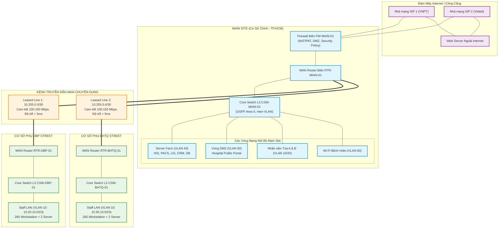

# BÁO CÁO SO SÁNH CÁC CÔNG NGHỆ WAN VÀ PHƯƠNG ÁN ĐỀ XUẤT
**Dự án:** Thiết kế hệ thống mạng Bệnh viện Đa khoa Chuyên sâu  
**Tác giả:** Bảo (Băng thông, Thiết bị & Công nghệ WAN)  
**Phối hợp:** Phước (Kiến trúc & IP), Toàn (Bảo mật), Trung (Mô phỏng & Cấu hình)  
**Tài liệu chuẩn:** Network Contract v1.1  

---

## 1. Bối cảnh và Yêu cầu kết nối WAN của Bệnh viện

Bệnh viện có 1 cơ sở chính (**Main Site**) và 2 cơ sở phụ (**Site DBP** và **Site BHTQ**). Đặc điểm luồng dữ liệu WAN bao gồm:
1. **Dữ liệu Y tế nhạy cảm và thời gian thực:**
   - Hệ thống thông tin bệnh viện (HIS), Xét nghiệm (LIS), Quản lý quan hệ bệnh nhân (CRM) và Cơ sở dữ liệu đặt tập trung tại Data Center Main Site.
   - Các máy trạm tại phòng ban của DBP và BHTQ phải truy vấn và cập nhật hệ thống thông tin bệnh viện (HIS, EMR) liên tục. Độ trễ yêu cầu <= 20 ms, tỷ lệ mất gói <= 0,1%.
2. **Hình ảnh Y khoa độ phân giải cao (RIS-PACS):**
   - Các file ảnh chụp cắt lớp vi tính (CT Scanner 128 lát, MRI, DSA tim mạch) có dung lượng từ 50 MB - 500 MB truyền về hội chẩn. Kênh WAN cần thông lượng lớn và khả năng burst tốt.
3. **Mọi lưu lượng Internet đi qua Main Site:**
   - Theo Network Contract v1.1, toàn bộ PC tại DBP và BHTQ không ra Internet trực tiếp mà đi xuyên kênh WAN về Main Site để đi qua Edge Firewall kiểm soát an ninh tập trung.
4. **Yêu cầu sẵn sàng cao (High Availability):**
   - Sự cố đứt cáp WAN không được phép làm tê liệt hoạt động cấp cứu và khám bệnh tại các chi nhánh.

---

## 2. So sánh toàn diện các Công nghệ WAN

Bảng so sánh 4 giải pháp WAN phổ biến hiện nay: **Leased Line truyền thống**, **MPLS VPN**, **SD-WAN (Software-Defined WAN)**, và **IPsec VPN qua Internet băng rộng (Broadband FTTH)**:

| Tiêu chí so sánh | 1. Leased Line (Point-to-Point) | 2. MPLS VPN (L3VPN / L2VPN) | 3. SD-WAN (Mạng WAN định nghĩa bằng phần mềm) | 4. IPsec VPN over Internet (FTTH) |
| :--- | :--- | :--- | :--- | :--- |
| **Bản chất công nghệ** | Kênh thuê riêng vật lý/logic dành riêng (Layer 1/2) qua mạng SDH/OTN hoặc Metro Ethernet. | Mạng riêng ảo chuyển nhãn đa giao thức do nhà mạng (ISP/SP) quản lý và gắn nhãn nhãn QoS. | Lớp mạng phủ (Overlay) thông minh trên mọi nền tảng truyền tải (Underlay: Leased Line, FTTH, 4G/5G). | Đường hầm mã hóa bảo mật (GRE/IPsec) đi trên mạng Internet công cộng không cam kết. |
| **Chi phí đầu tư (CAPEX)** | Thấp - Trung bình (chỉ cần Router có cổng GE/Serial/SFP). | Trung bình (cần router doanh nghiệp hỗ trợ định tuyến ISP). | Trung bình - Cao (cần thiết bị SD-WAN Edge hoặc bản quyền license vManage/Cloud). | Rất thấp (dùng router sẵn có hỗ trợ IPsec VPN). |
| **Chi phí vận hành (OPEX)** | **Rất cao** (cước hàng tháng đắt nhất, tính theo từng Mbps cam kết). | **Cao** (thấp hơn Leased Line nhưng cao hơn Internet nhiều lần). | **Tối ưu nhất** (kết hợp được đường FTTH giá rẻ với 1 đường leased line nhỏ). | **Rất rẻ** (chỉ tốn chi phí thuê bao Internet FTTH vài trăm nghìn/tháng). |
| **Hiệu năng & Băng thông** | Thông lượng tối đa bằng gói thuê; độ trễ cực thấp (<= 3-5 ms); không jitter. | Rất tốt, có cam kết độ trễ theo từng CoS/QoS của ISP. | Cực cao nhờ tính năng gộp băng thông (Bandwidth Aggregation) từ nhiều đường. | Phụ thuộc chất lượng Internet; có thể bị biến động trễ (jitter) và nghẽn giờ cao điểm. |
| **Độ tin cậy & SLA** | **Tối cao (99,99%)**, có bồi thường cam kết thời gian phục hồi MTTR nghiêm ngặt. | **Rất cao (99,9%)**, có SLA cam kết từ nhà mạng. | **Tuyệt đối cao**, tự động chuyển mạch sang đường dự phòng trong micro-giây khi có suy hao gói. | **Thấp - Trung bình**, Internet công cộng không có SLA cam kết dịch vụ. |
| **Bảo mật** | Tách biệt vật lý hoàn toàn, an toàn tự nhiên nhưng không có mã hóa payload mặc định. | Tách biệt theo VRF/VPN ID của nhà mạng, tin cậy ở mức nhà mạng. | Mã hóa đầu cuối (End-to-End IPsec AES-256), Zero-Trust Network Access (ZTNA) tích hợp. | Mã hóa mạnh IPsec (AES-256/SHA-2), an toàn trên môi trường Internet công cộng. |
| **Khả năng quản trị** | Thủ công từng thiết bị qua CLI; không có giám sát chất lượng ứng dụng tự động. | Cần phối hợp với ISP mỗi khi đổi routing/QoS; quản trị phức tạp. | **Giao diện tập trung trực quan (Single Pane of Glass)**; Zero-Touch Provisioning (ZTP). | Cấu hình từng router cục bộ; khó quản lý khi mở rộng nhiều chi nhánh. |
| **Khả năng định tuyến theo ứng dụng** | Không có (chỉ định tuyến theo địa chỉ IP/Subnet). | Định tuyến dựa trên DSCP/CoS cơ bản do nhà mạng map nhãn. | **Application-Aware Routing**: tự động chọn đường tối ưu cho HIS, PACS, Zoom dựa trên RTT/Jitter. | Không có hoặc cần cấu hình PBR phức tạp thủ công. |
| **Mức độ mô phỏng trên Packet Tracer** | **Rất tốt**, hỗ trợ đầy đủ Serial/Ethernet Point-to-Point và OSPF. | Hạn chế (CPT không mô phỏng đầy đủ MPLS PE-P-CE nhãn LDP/BGP). | **Không hỗ trợ** (Cisco Packet Tracer không có phần mềm vEdge/vManage SD-WAN). | Hỗ trợ mô phỏng IPsec VPN Site-to-Site cơ bản qua Router. |

---

## 3. Phân tích chi tiết và Lựa chọn phương án

### 3.1 Phương án Đề xuất cho Thiết kế Thực tế (Production Architecture)

Trong môi trường thực tế của một bệnh viện đa cơ sở, giải pháp lý tưởng nhất là **Mô hình Hybrid WAN tích hợp SD-WAN**:
- **Kênh chính (Primary WAN):** Sử dụng kênh **Metro Ethernet Leased Line 100 Mbps - 150 Mbps** kết nối trực tiếp từ Main Site đến DBP và BHTQ.
  - *Lý do:* Đảm bảo độ trễ tối thiểu tuyệt đối (< 5 ms), không suy hao gói cho dữ liệu y tế cứu mạng người (hội chẩn mổ, dữ liệu tim mạch, PACS, database HIS).
- **Kênh dự phòng (Secondary / Backup WAN):** Sử dụng **Đường truyền Internet FTTH Doanh nghiệp 300 Mbps - 500 Mbps** chạy đường hầm bảo mật **IPsec VPN** kết nối về Main Site.
  - *Lý do:* Chi phí cực kỳ rẻ (chỉ khoảng 1–2 triệu VNĐ/tháng), nhưng cung cấp băng thông dồi dào.
- **Lớp điều khiển thông minh SD-WAN Edge:**
  - Kích hoạt tính năng **Application-Aware Routing**:
    - Khi cả 2 đường hoạt động bình thường: Lưu lượng HIS, Database, PACS chạy trên Leased Line; lưu lượng Internet, Guest Wi-Fi và cập nhật phần mềm chạy qua FTTH VPN.
    - Khi đường Leased Line bị đứt: Toàn bộ lưu lượng y tế tự động bẻ ghi sang đường hầm IPsec VPN trong thời gian **< 1 giây**, người dùng không hề nhận ra sự gián đoạn.

### 3.2 Phương án Lựa chọn trong Đồ án Môn học và Mô phỏng Packet Tracer

Để đảm bảo tính khả thi cao nhất trên công cụ **Cisco Packet Tracer** mà nhóm đã thống nhất (theo Network Contract v1.1):
- **Công nghệ triển khai mô phỏng:** **Point-to-Point Leased Line (sử dụng Serial hoặc Gigabit Ethernet Routed Interfaces) kết hợp Giao thức định tuyến động OSPFv2 (Open Shortest Path First)**.
- **Phân bổ địa chỉ Subnet WAN theo Contract:**
  - Tuyến `MAIN - DBP`: Subnet `10.255.0.0/30`
    - IP đầu Main (RTR-MAIN hoặc CSW-MAIN): `10.255.0.1/30`
    - IP đầu DBP (RTR-DBP): `10.255.0.2/30`
  - Tuyến `MAIN - BHTQ`: Subnet `10.255.0.4/30`
    - IP đầu Main (RTR-MAIN hoặc CSW-MAIN): `10.255.0.5/30`
    - IP đầu BHTQ (RTR-BHTQ): `10.255.0.6/30`
- **Giao thức OSPFv2 (Process ID 1, Backbone Area 0):**
  - Tự động quảng bá dải mạng các site: Main (`10.10.0.0/16`), DBP (`10.20.0.0/16`), BHTQ (`10.30.0.0/16`).
  - Hội tụ nhanh khi có sự cố, dễ kiểm tra bằng các lệnh `show ip ospf neighbor`, `show ip route`.
- **Cơ chế dự phòng mô phỏng:**
  - Tại Main Site, mô phỏng 2 đường kết nối ra Internet qua ISP (sử dụng 2 địa chỉ IP Public khác nhau) cấu hình Default Route và Floating Static Route / IP SLA tracking hoặc cân bằng tải bằng Router biên.

---

## 4. Sơ đồ Kiến trúc WAN Logic và Luồng Dữ liệu (Mermaid Diagram)

Dưới đây là sơ đồ kiến trúc WAN kết nối giữa 3 site và Internet Edge:

---

## 5. Kết luận và Khuyến nghị Kỹ thuật cho Nhóm

1. **Về phía Phước (Kiến trúc & IP):**
   - Đảm bảo các cổng WAN trên router được gán chính xác IP `/30` theo bảng phân bổ đã chốt trong Contract v1.1.
   - Thể hiện rõ trên sơ đồ các cổng kết nối Uplink từ Core Switch Main sang Router biên WAN và sang Firewall.
2. **Về phía Toàn (Bảo mật):**
   - Xây dựng chính sách Firewall tại Main Site cho phép luồng định tuyến OSPF (IP Protocol 89) qua 2 đường Leased Line giữa Main và DBP/BHTQ.
   - Áp dụng cấu hình NAT Overload (PAT) cho cả 3 dải IP `10.10.0.0/16`, `10.20.0.0/16`, `10.30.0.0/16` khi truy cập Internet thông qua 2 cổng ra của Edge Firewall.
3. **Về phía Trung (Mô phỏng Cisco Packet Tracer):**
   - Cấu hình OSPF đơn vùng (Single-Area OSPF Area 0) trên RTR-MAIN, RTR-DBP và RTR-BHTQ để đảm bảo các PC tại DBP và BHTQ ping thông suốt đến Server Farm tại Main Site và ngược lại.
   - Kiểm tra định tuyến default route `0.0.0.0 0.0.0.0` được router biên Main quảng bá qua OSPF (`default-information originate`) để toàn bộ các site phụ tự động nhận diện lối thoát ra Internet.
